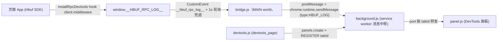

# HBuf RPC DevTools 插件实现规范

本文件是「类 Chrome DevTools Network 面板的 HBuf RPC 调试插件」的**设计与实现要点说明**，可在 Chrome DevTools 中以 Network 面板风格查看 HBuf RPC 请求/响应的**解码后数据**（带字段名 JSON）、traceId、耗时等信息，覆盖 HTTP（`HttpClient`/`FetchClient`）与 WebSocket（`WebSocketClient`）两种传输。

实现代码已落地，分两部分：

1. **SDK 埋点模块**（`src/hrpc/devtools.ts`）：在页面内以 `HandlerMiddleware` 形式 hook `Client.middleware`，把每次调用的解码后数据写入 `window.__HBUF_RPC_LOG__`；
2. **Chrome 扩展（MV3）**（`hbuf-devtools/` 目录，8 个文件）：读取页面日志并渲染成 DevTools 面板。

---

## 1. 背景与痛点

当前 hrpc 流量的特点决定了原生 DevTools Network 面板不够用：

| 问题 | 原因 |
|---|---|
| HTTP 请求体无法预览 | `HttpClient`/`FetchClient` 以 `POST application/octet-stream` 发送二进制 body |
| 响应不直观 | 响应包一层 `Result`（`{code, msg, data}`），原始 JSON 需人工解包 |
| HBuf 二进制无法解码 | 扩展运行在独立上下文，**拿不到页面 JS 里注册的 `Descriptor`**，二进制 body 无法还原为对象 |
| WebSocket 帧难读 | `WebSocketData` 信封（type/header/id/path/status/data）嵌套 `Result`，Network 面板按帧展示不友好 |

**核心结论**：解码必须在**页面内**完成（页面持有 Descriptor），扩展只负责**采集与展示**。因此采用「SDK 埋点 + DevTools 扩展」组合，而非扩展侧直接 hook 网络。

## 2. 方案选型

| 方案 | 描述 | 优点 | 缺点 | 结论 |
|---|---|---|---|---|
| A. SDK 埋点 + DevTools 扩展 | `installRpcDevtools` 以中间件形式 hook `client.middleware`，日志写入 `window.__HBUF_RPC_LOG__`，扩展渲染面板 | 数据已在页面内解码，带字段名；可拿到 traceId/耗时/传输类型；支持 HBuf 二进制编码；复用 SDK 已有中间件扩展点 | 需在页面调用一行安装代码 | **采用** |
| B. 扩展 hook 传输层 | content script 注入 MAIN world，hook `XMLHttpRequest.prototype.send` / `window.fetch` / `WebSocket.prototype.send` | 无需改 SDK | HBuf 二进制编码只能显示 hex；无法区分已解码字段；hook 易被站点防检测干扰 | 备选，仅对 JSON 编码流量有效 |

## 3. 整体架构



### 3.1 数据流

1. **埋点**：`installRpcDevtools(client, transport, base)` 以中间件形式 hook `client.middleware`（位于中间件链最外层），**异步记录**：`next` 之前 `pushLog` 写入 pending 条目（含请求体，`status: "pending"`），`next` 完成后 `updateLog` 更新同一条目（响应体、耗时、错误，`status: "done"`），条目 `unshift` 到 `window.__HBUF_RPC_LOG__`（上限 300 条），新增/更新都 `dispatchEvent(new CustomEvent("__hbuf_rpc_log__", {detail: 条目}))` 通知扩展；
2. **采集**：`content.js`（ISOLATED world，`document_start`）以 `<script src=chrome.runtime.getURL("bridge.js")>` 注入 MAIN world 桥，桥与页面共享 `window`，事件 `detail` 携带单条日志时**即时单条推送**（覆盖新增与更新），加载完成后**全量补发**已有日志（`lastLength` 初始 0）并监听事件增量发送（按 `lastLength` 截断），经 `window.postMessage` 回传 content，再由 `chrome.runtime.sendMessage` 发给 background；
3. **路由**：background 维护 `tabId -> Set<Port>` 映射；DevTools 面板打开时 `chrome.runtime.connect({name: "HBUF_PANEL"})` 并发送 `REGISTER {tabId}`；background 收到 content 消息后按 `sender.tab.id` 转发给对应面板的 port；
4. **展示**：`panel.js` 以 Network 面板同款表格渲染列表（状态、方法、名称、类型、耗时、开始时间列，按 ts 倒序最新在前），点击条目在下方详情区**左右分栏**同时展示请求与响应，JSON 以**可折叠树**呈现。

### 3.2 为什么用「content script + bridge.js 注入」双层结构

日志数组写在页面 `window` 上，而 content script 默认运行在 ISOLATED world：共享 DOM 但**不共享 window**，无法直接读取。MV3 的 `"world": "MAIN"` 特性（Chrome 102+）在部分环境存在兼容性问题，因此采用注入桥方案（Vue DevTools / Redux DevTools 同款）：

1. `content.js` 以默认 ISOLATED world 注入（兼容所有 Chrome 版本），以 `<script src=chrome.runtime.getURL("bridge.js")>` 注入 MAIN world；
2. `bridge.js` 在 MAIN world 执行，与页面共享 `window`，直接读 `window.__HBUF_RPC_LOG__`，并通过 `window.postMessage` 回传日志；
3. `bridge.js` 需声明在 `web_accessible_resources` 中才能被页面加载；
4. 桥同时设置诊断标记 `window.__HBUF_RPC_CONTENT__ = true`，页面 console 可直接验证注入是否成功。

**CSP 约束**：页面 `script-src` 不允许内联脚本（无 `'unsafe-inline'`）时，`<script>.textContent` 同步注入会被拦截；`<script src>` 注入则要求 `script-src` 放行扩展源（`chrome-extension://<扩展ID>/`）。两种注入方式都受页面 CSP 约束，需按目标页面实际 CSP 选择（本方案默认 `<script src>`，若页面 CSP 未放行扩展源，需在页面 CSP 中加入扩展源）。

**异步加载时序（全量补发）**：`<script src>` 异步加载，桥加载完成前 SDK 已写入的日志无法靠事件监听捕获。解决办法：桥的 `lastLength` 初始化为 0，加载完成后立即 `collect()` 一次，把已有日志**全量补发**——面板侧按 `id` 去重，不会重复展示；之后事件 + 1s 轮询双通道保证实时。

---

## 4. SDK 侧改动

### 4.1 SDK 埋点：`rpc.ts` 前置改动 + 新增 `src/hrpc/devtools.ts`

**设计原则**：埋点以 `HandlerMiddleware` 形式 hook `client.middleware`（`Client.middleware` 为 public 字段，可直接替换），位于整个中间件链**最外层**，记录的是含用户中间件处理的总耗时；**不修改 `http.ts` / `websocket.ts` 任何现有逻辑**；返回卸载函数便于关闭调试。

**`rpc.ts` 前置改动**：中间件层只能拿到 `opt`，拿不到 `invoke` 内部拼接的完整路径（`name/method`）与 notification 标志，因此 `Option` 补充两个可选字段 `path`、`notification`（均由 `invoke` 写入），`invoke` 传参处补 `path: name + method` 与 `notification: desc == null`。

**`devtools.ts` 核心逻辑**（完整代码见 `src/hrpc/devtools.ts`）：

- `pushLog`：`next` 之前写入 pending 条目（`status: "pending"`，含 `toJson` 后的请求体、path、traceId、发出时刻 `ts`），返回条目 `id`；
- `updateLog`：`next` 完成后（成功或失败）按 `id` 原地更新同一条目（响应体、耗时、错误，`status: "done"`），`ts` 不变，列表顺序稳定；
- `dispatchLog`：新增与更新都派发 `CustomEvent("__hbuf_rpc_log__", {detail: 条目})`，桥据此即时单条推送（不等 1s 轮询）；
- `toJson`：HData 走 `descriptor.toJson`（带字段名）；ArrayBuffer → `{__bytes__, __hex__}`；Blob → `{__blob__}`；`RpcError` → `{code, msg}`；
- 数组上限 300 条，超出截断。

### 4.2 日志条目字段说明

| 字段 | 类型 | 说明 |
|---|---|---|
| `id` | number | 页面内自增序号（`logSeq`） |
| `ts` | number | 请求发出时刻毫秒时间戳（`pushLog` 写入，`updateLog` 不变，列表顺序稳定） |
| `transport` | `"http" \| "websocket"` | 传输类型，面板徽标用 |
| `path` | string | 完整路径（`base + opt.path`），如 `http://localhost:8080/api/user/info`（`opt.path` 由 `invoke` 写入的 `name/method`） |
| `notification` | boolean | 是否单向通知（来自 `opt.notification`，`invoke` 写入的 `desc == null`） |
| `traceId` | string? | 来自 `opt.traceId`（`X-Trace-Id` 请求头同源） |
| `req` | any | 请求体：HData → `toJson`；ArrayBuffer → `{__bytes__, __hex__}`；`undefined` → `null` |
| `resp` | any | 响应体：`desc != null` 时为 `Client.invoke` 已解包的 `Result.data`；`desc == null` 时为原始 ArrayBuffer 的 hex 摘要 |
| `duration` | number? | 耗时毫秒（`performance.now()` 差值，含中间件链总耗时）；pending 状态不携带 |
| `reqHeaders` | `Record<string, string>`? | 请求头：响应回来后从 `opt.headers` 记录（传输层如 FetchClient 会把 `X-Trace-Id` 追加进 `opt.headers`；XHR/WS 场景可能为空）；pending 状态不携带 |
| `error` | string? | 失败时：`RpcError.msg` 或异常 message；成功时不携带 |
| `status` | `"pending" \| "done"` | 请求状态：`pushLog` 写 `pending`（已发送待响应），`updateLog` 写 `done`（已收到响应/失败） |

**响应解包路径说明**：`Client.invoke` 中 `desc != null` 时响应经 `NewResultDesc(desc)` 解码并解包为 `Result.data`，因此埋点拿到的 `resp` 已是**业务数据对象**，`toJson` 后即带字段名的 JSON；`desc == null`（如 notification 或原始调用）时 `resp` 为 `ArrayBuffer`，展示为 hex 摘要。业务异常（`code != 0`）在 `invoke` 中 `throw resp`（`Result` 实例），埋点 catch 后 `resp` 记录 `{code, msg}`，`error` 记录 `msg`。注意：埋点中间件位于中间件链最外层，`duration` 为含用户中间件处理的总耗时，而非纯网络耗时。

### 4.3 修改 `src/index.ts` 导出

在 `src/index.ts` 中：import 区引入 `installRpcDevtools`；命名导出列表与 `export default` 对象中均新增 `installRpcDevtools`；类型导出区新增 `HbufRpcLogEntry`。

### 4.4 页面启用示例

在页面构造 `Client` 后调用一行 `installRpcDevtools(client, transport, base)` 即可开启（HTTP 场景 `transport` 传 `"http"`、`base` 传服务前缀；WebSocket 场景传 `"websocket"`、`base` 传 `""`）；返回值为卸载函数，调用即可恢复原始 middleware。生产环境建议用环境变量或 URL 参数控制开关，避免向 `window` 写入数据。SDK 埋点默认不开启，不调用 `installRpcDevtools` 则零开销。

---

## 5. Chrome 扩展实现（MV3）

### 5.1 目录结构

```
hbuf-devtools/
├── manifest.json     # MV3 清单
├── content.js        # ISOLATED world，注入 bridge 并转发日志
├── bridge.js         # MAIN world 桥，采集 window.__HBUF_RPC_LOG__
├── background.js     # service worker，按 tabId 路由消息
├── devtools.html     # devtools_page 入口页
├── devtools.js       # 创建 DevTools 面板
├── panel.html        # 面板结构
├── panel.css         # 面板样式（暗色）
└── panel.js          # 面板逻辑（列表 + JSON 详情）
```

### 5.2 manifest.json

完整配置见 `hbuf-devtools/manifest.json`（版本 1.3.0）。要点：

- content script 使用默认 ISOLATED world（不依赖 `world: "MAIN"` 特性，兼容所有 Chrome 版本）；
- `web_accessible_resources` 声明 `bridge.js` 可被页面加载（content script 注入的 `<script src>` 指向它；页面 `script-src` 需放行扩展源，内联脚本会被拦截）；
- `run_at: "document_start"`：尽早注入桥，桥加载完成后全量补发已有日志，不漏早期事件；
- 无需任何 host 权限与 `chrome.devtools` 之外的权限。

### 5.3 content.js（ISOLATED world，转发器）

完整代码见 `hbuf-devtools/content.js`。要点：

- 动态插入 `<script src=chrome.runtime.getURL("bridge.js")>` 注入 MAIN world 桥；
- 监听 `window.postMessage` 的 `{type:"HBUF_LOG", entries}`，转发给 background；
- `<script src>` 注入受页面 CSP 约束：`script-src` 需放行扩展源；`onerror` 给出明确 console.warn 提示如何修复；
- **失败提示**：MV3 `sendMessage` 返回 Promise，异步 reject（扩展 reload 后旧页面上下文失效）必须 `.catch` 处理并提示刷新页面，否则静默丢日志；
- **失效防刷屏**：扩展 reload 后旧页面上下文失效（`Extension context invalidated`），桥仍每 1s 轮询发消息——捕获后只警告一次并移除 message listener，静默丢弃后续消息，避免控制台刷屏；恢复日志采集需刷新页面。

### 5.4 bridge.js（MAIN world 桥，采集器）

完整代码见 `hbuf-devtools/bridge.js`。要点：

- **事件单条推送**：SDK 事件 `detail` 携带单条日志（新增 pending 或更新 done），桥直接即时推送，无需等 1s 轮询——这是「响应回来立即更新面板」的实时性保证；
- **全量补发**：`lastLength` 初始 0，桥加载完成后立即 `collect()`，把异步加载窗口期内已写入的日志一次性送出；面板侧按 `id` upsert，不会重复展示；
- **增量发送**：日志 `unshift` 到数组头部，新条目总是前 `logs.length - lastLength` 个，之后只发增量；
- `safeClone` 用 JSON 序列化保证 `postMessage`/`sendMessage` 的结构化克隆安全（Decimal、Date 等已在 SDK 侧 `toJson` 转为普通值）；
- 事件 + 1s 轮询双通道：事件保证实时，轮询兜底（页面刷新、事件丢失等竞态）；
- **诊断标记** `window.__HBUF_RPC_CONTENT__`：由桥在 MAIN world 设置，页面 console 可直接验证注入是否成功；
- **防重复注入**：`window.__HBUF_RPC_BRIDGE__` 标记保证每帧只初始化一次桥。

### 5.5 background.js

完整代码见 `hbuf-devtools/background.js`。要点：

- background 是**消息中枢 + 短期缓存**：缓存每个 tab 最近 200 条日志（MV3 service worker 会被回收，内存缓存不保证持久，但覆盖“面板打开晚于请求”的常见时序）；缓存按 `id` 覆盖，同一 RPC 的 pending/done 只保留最新一条；
- 面板 `REGISTER` 时**回放缓存快照**，因此无论先触发 RPC 还是先打开面板，列表都不会为空；
- 每个面板 port 注册时携带 `tabId`，按 `sender.tab.id` 精确路由，避免多个标签页互相串数据；
- `onDisconnect` 清理映射，防止面板关闭后端口泄漏。

### 5.6 devtools.html / devtools.js

`devtools.html` 为 devtools_page 入口页（引入 `devtools.js`）；`devtools.js` 取 `chrome.devtools.inspectedWindow.tabId`，`panels.create("HBuf RPC", "", "panel.html?tabId=" + tabId)` 创建面板。`tabId` 通过 URL 查询参数传给面板，panel 用它向 background 注册路由。

### 5.7 panel.html

完整代码见 `hbuf-devtools/panel.html`。布局参考 Chrome Network 面板：上工具栏（过滤框/清空/HTTP 与 WebSocket 类型过滤按钮/计数），中部表格式列表（列头与数据行共用 grid 模板，列头 sticky），下部详情区（**默认隐藏**，点击列表行才展开）：详情头（path + 状态/耗时/traceId/错误元信息）+ **请求头区**（Network Headers tab 同款：General 组 Request URL/Method/Type + Request Headers 键值组）+ 请求/响应**左右分栏**同时展示，无需来回切换标签页。

### 5.8 panel.css

完整代码见 `hbuf-devtools/panel.css`。暗色主题 CSS 变量（背景/边框/强调色/绿红状态色/选中色）；列表为 Network 风格 grid 表格，列头 sticky、悬停/选中/错误行高亮；状态列红/绿/灰圆点 + 状态码；**类型过滤按钮**为 Network 同款 pill toggle（未选中灰字低亮，选中蓝底白字）；**请求头区**固定于详情头下方（`max-height` 35% 可滚动，分组标题蓝字、键灰值白键值行，标题可点击折叠/展开）；详情区左右分栏（`grid-template-columns: 1fr 1fr`）；JSON 折叠树配色（key 蓝、string 橙红、number 绿、bool/null 蓝、`▸/▾` 箭头灰）。

### 5.9 panel.js

完整代码见 `hbuf-devtools/panel.js`。要点：

- 列表按 `ts` 倒序排序（最新在前），回放缓存与实时增量的插入顺序不再影响展示顺序；条目按 `id` **upsert**——新 id 追加，已有 id 就地替换（pending → done），响应回来不跳位置、不重复；
- **类型过滤**：工具栏 HTTP/WebSocket 为 Network 同款 toggle 按钮，无选中 = 显示全部，有选中 = 只显示选中类型（并集），与文本过滤叠加生效；
- **请求头区**：选中条目后渲染 General 组（Request URL/Method/Type）与 Request Headers 键值组；`reqHeaders` 为空时提示「（未设置）」，`traceId` 存在时补充为 `x-trace-id` 展示；pending 条目提示「（响应返回后记录）」，响应回来后随 `refreshDetail` 自动刷新；
- **异步日志展示**：`status: "pending"` 的条目显示灰色圆点 + `···` 状态码 + `···` 耗时，响应回来变为绿点 `200` + 实际耗时；选中 pending 条目时详情区响应侧显示「等待响应…」，响应回来后自动实时刷新（`refreshDetail`）；
- 请求/响应左右分栏同时展示，无需来回切换标签页；JSON 折叠树默认展开根节点、折叠子节点，点击 `▸/▾` 逐级展开/收起，`Array(n)` / `{n keys}` 提示元素数；**展开状态按「容器 id + 字段路径」记忆**（`expandedPaths`），条目 pending→done 更新重建树后用户展开/收起的选择不丢失；
- 空对象/数组显示 `{}` / `[]`；`desc == null` 的原始调用响应无数据时显示占位说明；
- 状态列红/绿/灰圆点 + 状态码（成功 `200`、失败 `ERR`、待响应 `···`）、method 列区分 `POST`/`NOTIFY`、类型列 http/websocket 徽标，与 Network 面板交互一致；错误条目整行 name 标红。

---

## 6. 通信协议约定

| 通道 | 方向 | 消息 | 说明 |
|---|---|---|---|
| SDK → bridge | window 事件 | `CustomEvent("__hbuf_rpc_log__", {detail: 条目})` | SDK `pushLog`（新增 pending）/`updateLog`（更新 done）触发，桥据此即时单条推送 |
| bridge → content | `window.postMessage` | `{type:"HBUF_LOG", entries}` | bridge 增量推送日志（加载后全量补发一次 + 1s 轮询兜底） |
| content → background | `chrome.runtime.sendMessage` | `{type:"HBUF_LOG", href, entries}` | entries 为增量日志数组 |
| panel → background | port `{name:"HBUF_PANEL"}` | `{type:"REGISTER", tabId}` | 面板打开时注册 |
| background → panel | port | `{type:"HBUF_LOG", entries}` | 按 tabId 路由转发；面板注册时先回放缓存快照 |

## 7. 安装与使用

1. **SDK 侧**：按第 4 节实现 `devtools.ts`、修改 `index.ts` 导出，页面按 4.4 示例调用 `installRpcDevtools`；
2. **扩展侧**：按第 5 节创建 `hbuf-devtools/` 目录下 8 个文件；
3. Chrome 打开 `chrome://extensions`，右上角开启「开发者模式」；
4. 点「加载已解压的扩展程序」，选择 `hbuf-devtools/` 目录；
5. 打开应用页面，F12 → DevTools 中点击新增的 **HBuf RPC** 标签页；
6. 触发 RPC 调用：请求发出瞬间列表即出现灰色 pending 记录，响应回来自动更新为绿色 `200` + 耗时；点击条目在详情区**左右分栏**同时查看请求/响应，JSON 树可折叠展开；
7. 修改扩展文件后，在 `chrome://extensions` 点刷新按钮，重新打开 DevTools 面板生效；**注意：每次加载或刷新扩展后，已打开的业务页面必须刷新一次**（content script 只在页面加载时注入）。

## 8. 设计要点与注意事项

1. **解码必须留在页面内**：扩展无法访问页面的 Descriptor 闭包，任何在扩展侧解码 HBuf 二进制的尝试都不可行——这是整个方案以 SDK 埋点为前提的根本原因；
2. **不侵入现有代码**：`installRpcDevtools` 仅替换 `client.middleware` 字段并保存原始引用，`http.ts`/`websocket.ts` 零改动，`rpc.ts` 仅补充 `Option` 两个可选字段与 `invoke` 一处传参；卸载函数可恢复；
3. **注入桥方案**：content script 用默认 ISOLATED world 注入，`bridge.js` 以 `<script src>` 形式注入 MAIN world 采集日志，兼容所有 Chrome 版本；受页面 CSP 约束——内联脚本需 `'unsafe-inline'`，`<script src>` 需放行扩展源（`chrome-extension://<扩展ID>/`），页面 CSP 未放行时注入会被阻止（页面 console 会报 CSP 违规并触发 `onerror` 提示）；
4. **MV3 service worker 内存不持久**：background 只缓存每个 tab 最近 200 条日志用于面板注册时回放，页面 `window`（最多 300 条）与面板内存（最多 500 条）是日志的实际存储，页面刷新或面板关闭后历史日志不保留；
5. **多标签页隔离**：按 `tabId` 路由，两个标签页互不串数据；
6. **序列化安全**：SDK 侧 `toJson` 已把 Decimal/Date/BigInt 等转为 JSON 安全值；桥侧 `safeClone` 与 `postMessage` 的 try/catch 兜底不可克隆异常；
7. **性能**：埋点包装对每次请求增加一次 `pushLog`（unshift + 事件）与一次 `updateLog`（查找 + 事件），开销可忽略；生产环境建议按环境变量关闭；
8. **HBuf 二进制编码流量**：响应 `desc != null` 时仍能展示完整解码数据（解码在页面内完成），仅 `desc == null` 的原始调用展示 hex 摘要。

## 9. 验收标准

1. `npx tsc --noEmit` 通过（SDK 侧改动无类型错误）；
2. 页面调用 `installRpcDevtools` 后，`window.__HBUF_RPC_LOG__` 中能查到 RPC 记录，`resp` 为带字段名的 JSON 对象；
3. 扩展加载后，DevTools 出现「HBuf RPC」面板；
4. HTTP 与 WebSocket 两种传输的请求均出现在列表中，徽标正确；
5. 失败请求（业务错误 `code != 0` 或网络错误）显示红色状态灯，详情中能看到 `{code, msg}` 与错误信息；
6. 两个不同标签页同时打开面板，各自只显示本页面的日志；
7. 触发超过 300 条请求后，`window.__HBUF_RPC_LOG__` 长度保持 300（旧条目被截断）；
8. 面板与 Network 一致：请求发出即出现 pending 行（灰色 `···`），响应回来原地更新为 `200` + 耗时；默认不显示请求体/响应体，点击列表行才展开详情区（请求头 + 请求/响应体左右分栏，JSON 节点可折叠/展开）；工具栏 HTTP/WebSocket 过滤按钮能正确筛选对应类型的请求。

## 10. 后续扩展方向

1. **服务端视角**：包装 `Server.response` 记录 handler 侧耗时/错误，扩展增加「服务端」标签页；
2. **请求重放**：面板加「重放」按钮，调用页面暴露的 `client.invoke` 重发请求；
3. **HAR 导出**：将日志导出为 HAR 格式文件；
4. **HBuf 二进制 hex 全量查看**：对 `__hex__` 摘要提供完整 hex dump 视图；
5. **过滤增强**：按传输类型、状态（成功/失败）、时间范围过滤；
6. **无 SDK 改动的 hook 方案**（备选 B）：hook `XMLHttpRequest.prototype.send`、`window.fetch`、`WebSocket.prototype.send` 抓原始流量，仅对 JSON 编码有效，作为 SDK 不可用时的降级手段。
